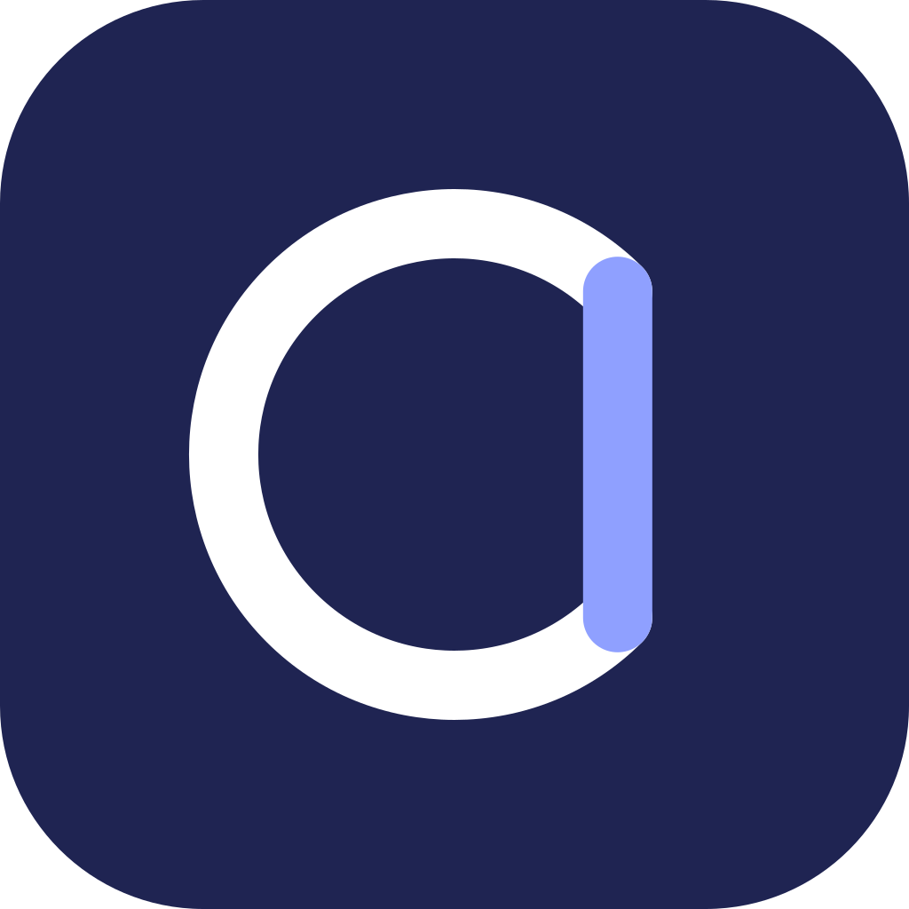
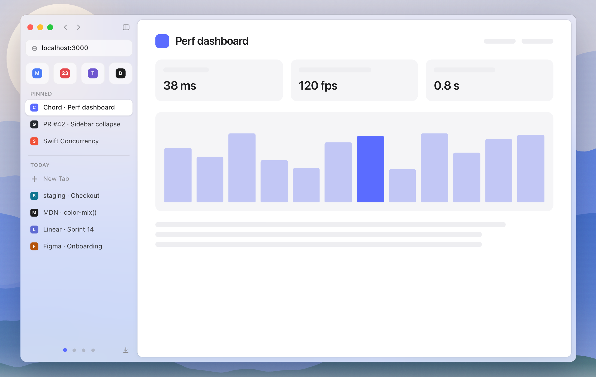
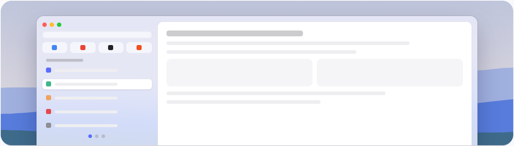
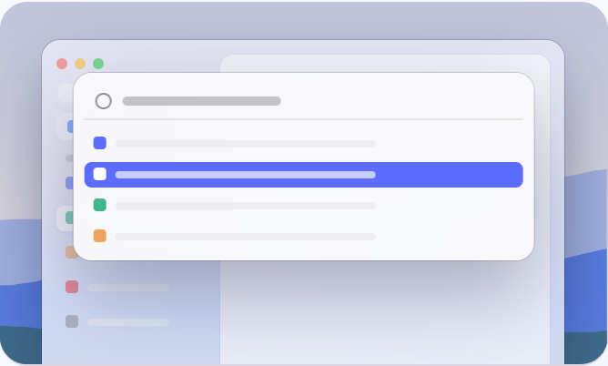
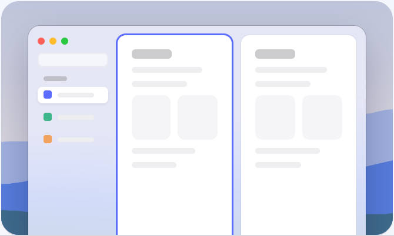
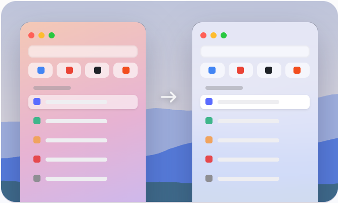
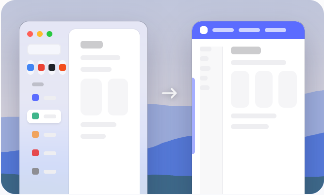

<div align="center">



# Chord

**The browser that closes the arc.**

Arc's sidebar, Spaces and command bar, rebuilt natively for the Mac on Chromium.<br>
Open source, so it can never disappear.

[](https://github.com/kevbesset/Chord/releases/latest)
[](https://kevbesset.github.io/Chord/)
[](LICENSE)
[](https://ko-fi.com/kevbesset)

[**Website**](https://kevbesset.github.io/Chord/) ·
[**Download**](https://github.com/kevbesset/Chord/releases/latest) ·
[Changelog](CHANGELOG.md) ·
[Build from source](#build)

<br>

<picture>
  <source media="(prefers-color-scheme: dark)" srcset="docs/assets/readme/demo-dark.png">
  
</picture>

<sub>Try the interactive version on <a href="https://kevbesset.github.io/Chord/">kevbesset.github.io/Chord</a>.</sub>

</div>

> [!NOTE]
> **Preview.** Chord is used every day by its author, but anything can still change.
> It runs on Macs with Apple silicon (M1 or later), macOS 14 or later.

## Install

Download `Chord-<version>.dmg` from the
[latest release](https://github.com/kevbesset/Chord/releases/latest) (or from
[the website](https://kevbesset.github.io/Chord/)), open the image and drag Chord into
Applications. Chord then updates itself: it checks once a day and installs at the next
launch; "Check for Updates…" in the Chord menu checks right away.

> [!IMPORTANT]
> Until Chord is notarized by Apple, macOS refuses to open it the first time:
> System Settings › Privacy & Security › "Open Anyway". Or, in a terminal:
>
> ```bash
> xattr -dr com.apple.quarantine /Applications/Chord.app
> ```

## Everything you loved in Arc, where you left it

Same model, same shortcuts. Coming from Arc, there is nothing to relearn.

<table>
  <tr>
    <td colspan="2" align="center">
      <picture>
        <source media="(prefers-color-scheme: dark)" srcset="docs/assets/readme/feature-sidebar-dark.png">
        
      </picture>
      <h3>Sidebar and Spaces</h3>
      Favorites, pinned tabs with folders, today's tabs. Each Space is its own profile,
      with its cookies and extensions. Swipe with two fingers to switch.<br>
      <kbd>⌘S</kbd> <kbd>⌃1</kbd>…<kbd>⌃9</kbd>
    </td>
  </tr>
  <tr>
    <td width="50%" align="center" valign="top">
      <picture>
        <source media="(prefers-color-scheme: dark)" srcset="docs/assets/readme/feature-command-bar-dark.png">
        
      </picture>
      <h3>Command bar</h3>
      Tabs, actions and search in one place, from the keyboard.<br>
      <kbd>⌘T</kbd> <kbd>⌘L</kbd>
    </td>
    <td width="50%" align="center" valign="top">
      <picture>
        <source media="(prefers-color-scheme: dark)" srcset="docs/assets/readme/feature-peek-dark.png">
        
      </picture>
      <h3>Peek</h3>
      Preview a link in a floating window without leaving the page.<br>
      <kbd>⇧</kbd> click
    </td>
  </tr>
  <tr>
    <td align="center" valign="top">
      <picture>
        <source media="(prefers-color-scheme: dark)" srcset="docs/assets/readme/feature-split-dark.png">
        
      </picture>
      <h3>Split view</h3>
      Two to four pages side by side, each with its own address.<br>
      <kbd>⌃⇧=</kbd>
    </td>
    <td align="center" valign="top">
      <picture>
        <source media="(prefers-color-scheme: dark)" srcset="docs/assets/readme/feature-little-window-dark.png">
        
      </picture>
      <h3>Little window</h3>
      Links from other apps open in a small floating window. Keep it, or send it to your Space.<br>
      <kbd>⌥⌘N</kbd>
    </td>
  </tr>
  <tr>
    <td align="center" valign="top">
      <picture>
        <source media="(prefers-color-scheme: dark)" srcset="docs/assets/readme/feature-import-dark.png">
        
      </picture>
      <h3>Import from Arc</h3>
      Spaces, favorites, pinned tabs, passwords, history and logins, in one click at first launch.
    </td>
    <td align="center" valign="top">
      <picture>
        <source media="(prefers-color-scheme: dark)" srcset="docs/assets/readme/feature-edgeless-dark.png">
        
      </picture>
      <h3>Edgeless</h3>
      The page reaches the window's edges; hide the sidebar too, and the site takes the whole window.<br>
      View › Edgeless Mode
    </td>
  </tr>
</table>

And the rest: automatic picture in picture, discreet permission requests, site
settings, find in page, zoom per site, saved passwords and autofill, private browsing,
multiple windows, light and dark mode, remappable shortcuts. In English, French and
Spanish, following the Mac's language.

## Built for the people who build the web

localhost, staging, production, docs, dashboards, pull requests: Chord keeps them all in
reach, on the engine you already test against.

| | |
|---|---|
| 🧩 **Chrome extensions** | From the Chrome Web Store, pinnable in the address bar. |
| 🛠️ **Docked DevTools** | Chrome's DevTools on the right, left, bottom or in their own window (<kbd>⌥⌘I</kbd>). |
| 🍎 **Native to the Mac** | The interface is written in Swift and AppKit, with real macOS glass. No Electron. |
| 🛡️ **Chromium, ungoogled** | Built on [ungoogled-chromium](https://github.com/ungoogled-software/ungoogled-chromium): Chromium's engine without Google's services. No account required. |

## Every interaction has a budget

Smoothness isn't a promise, it's a rule: each interaction has a latency budget
([`docs/PERFORMANCE.md`](docs/PERFORMANCE.md)), and a feature that goes over it doesn't
ship.

| Command bar | Switching Spaces | Cold start | Scrolling and animations |
|:---:|:---:|:---:|:---:|
| **< 50 ms** | **< 100 ms** | **< 1 s** to a usable window | **120 fps** on ProMotion |

## Support

Chord is free and made by one person. If it is useful to you, you can support its
development on [Ko-fi](https://ko-fi.com/kevbesset). Bugs are welcome in the
[issues](https://github.com/kevbesset/Chord/issues), ideas and questions in the
[discussions](https://github.com/kevbesset/Chord/discussions).

## Contributing

Fixes, translations and performance work are welcome; a new feature starts with an
issue. Working on the interface doesn't require building Chromium: `engine/scripts/run.sh`
puts your build of it into the latest release. Everything is in
[`CONTRIBUTING.md`](CONTRIBUTING.md); security issues go through [`SECURITY.md`](SECURITY.md).

## Build

Requirements: Apple Silicon Mac, Xcode 16 or later, Homebrew, about 100 GB of free
space. The first Chromium build takes several hours.

```bash
brew install xcodegen
engine/scripts/bootstrap.sh && engine/scripts/prepare.sh
engine/scripts/build.sh          # Chromium and ChordUI: out/Chord/Chord.app
engine/scripts/run.sh            # day to day: the interface alone, in a few seconds
```

Details in [`engine/README.md`](engine/README.md). Publishing a version:
[`docs/RELEASING.md`](docs/RELEASING.md).

<details>
<summary><b>Repository structure</b></summary>

```
app/                Native interface (Swift, AppKit)
  ChordUI/          framework: window, sidebar, Spaces, command bar.
                    Knows no engine, only the ChordWebEngine protocol.
  scripts/          checks run by CI (every string in French and Spanish)
  project.yml       Xcode project definition (XcodeGen)
engine/             Chromium: pinned version, //chord, patches, brand, scripts
docs/               Product vision, architecture, performance budgets, decisions
design/             Reference mockups and brand (logo, icon)
site/               Presentation page (en/fr/es), published on GitHub Pages;
                    ?mock in its address shows controls to try each platform
CLAUDE.md           Project context for Claude Code
```

To go further: [vision](docs/VISION.md), [architecture](docs/ARCHITECTURE.md),
[decisions](docs/decisions/).

</details>

## License

Chord is distributed under the GNU General Public License, version 3
([`LICENSE`](LICENSE)). Chromium and ungoogled-chromium, which it builds on, keep their
own licenses (mostly BSD); Chord lists them in `chord://credits`. Sparkle (updates) is
under the MIT license.

<div align="center">
<br>

<br>
<sub><a href="https://kevbesset.github.io/Chord/">kevbesset.github.io/Chord</a></sub>
</div>
